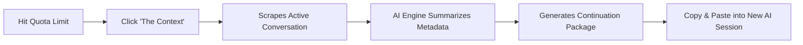

<div align="center">

  

  # The Context

  ### *One click. Zero context loss. Never start over.*

  An intelligent, open-source Chrome extension that scans your active AI conversations across 10+ platforms and produces a structured, paste-ready **Continuation Package** — allowing you to bypass quota limits and resume immediately in another session or platform.

  <br />

  [](./CHANGELOG.md)
  [](./manifest.json)
  [](./LICENSE)
  [](#privacy--security)
  [](#supported-ai-inference-engines)

</div>

---

## ⚡ The Problem

When deep in a coding session, research thread, or architecture review, reaching an AI **rate or quota limit** breaks your flow. Moving to another account or platform usually requires:
- Copying disconnected fragments of chat history.
- Re-explaining rules, tech stacks, and established decisions from scratch.
- Manually summarizing what the AI was in the middle of doing.

**The Context** automates this entirely. With a single click, it captures the conversation, extracts critical metadata via high-speed AI inference, and generates a structured Continuation Package that any AI can pick up instantly.

---

## 🔄 User Flow



---

## 🌐 Supported Chat Platforms

The Context features robust DOM scrapers equipped with multi-tier fallback selectors, container scroll traversal, and heuristic role detection:

| Platform | Target URL | Scraper Method |
| :--- | :--- | :--- |
| **Claude.ai** | `claude.ai/chat/*` | Turn-based selectors, internal API probe & class traversal |
| **ChatGPT** | `chatgpt.com/*`, `chat.openai.com/*` | Conversation-turn articles & `data-message-author-role` |
| **Google Gemini** | `gemini.google.com/*` | Custom web components (`<user-query>`, `<model-response>`) |
| **DeepSeek Chat** | `chat.deepseek.com/*` | Container traversal & markdown content grouping |
| **Perplexity AI** | `perplexity.ai/*` | Query container & answer block parsing |
| **Mistral Chat** | `chat.mistral.ai/*` | Chat message wrappers & bubble role mapping |
| **Microsoft Copilot** | `copilot.microsoft.com/*` | Copilot turn & message bubble detection |
| **Grok (xAI)** | `grok.com/*`, `x.com/i/grok*` | Response wrapper & user prompt pairing |
| **Poe** | `poe.com/*` | Chat message containers & author attributes |
| **HuggingChat** | `huggingface.co/chat/*` | Svelte message turns & markdown blocks |
| **Universal Fallback** | *Any conversational interface* | Heuristic role classifier & raw text fallback |

---

## 🧠 Supported AI Inference Engines

Configure any of the following 10 providers in the Settings tab. All requests are dispatched directly from your browser to the provider:

| Provider | Default / Recommended Model | Capabilities |
| :--- | :--- | :--- |
| **Google Gemini** | `gemini-2.0-flash` | Ultra-fast token processing, generous free tier |
| **Groq** | `llama-3.3-70b-versatile` | Blazing-fast inference speeds (~500+ tok/s) |
| **DeepSeek API** | `deepseek-chat`, `deepseek-reasoner` | High-precision instruction following, low cost |
| **OpenRouter** | `google/gemini-2.0-flash:free`, custom | Unified gateway to 100+ open & commercial models |
| **OpenAI** | `gpt-4o-mini`, `gpt-4o` | Reliable structured header generation |
| **NVIDIA NIM** | `meta/llama-3.3-70b-instruct` | Enterprise-grade hosted open models |
| **Ollama** | `llama3.3:latest` *(Local)* | **100% offline, zero-data-leak** local LLM inference |
| **Mistral AI** | `mistral-large-latest` | Multilingual & reasoning performance |
| **Cerebras** | `llama-3.3-70b` | Extreme token velocity inference |
| **SambaNova** | `Meta-Llama-3.3-70B-Instruct` | High-throughput AI cloud |

---

## 🚀 Key Features

### 1. Intelligent AI Routing & Failover Strategies
Choose between 3 distinct execution modes in Settings:
- **Cascade Fallback (Default)**: Tries your primary provider first. If a rate limit (HTTP 429), quota exhaustion, or server error occurs, it automatically transitions to the next available configured provider.
- **Round-Robin Rotation**: Cycles evenly across all configured providers on every generation to spread token load and preserve rate limits.
- **Fusion Mode**: Synthesizes continuation context across a panel of models with an automated judge.

### 2. High-Density Continuation Architecture
Rather than producing a lossy summary, The Context outputs a standardized **Session Header** paired with the verbatim conversation:
```
╔══════════════════════════════════════════════════╗
║         CONTEXT CARRY — SESSION HEADER           ║
╚══════════════════════════════════════════════════╝

📌 QUICK BRIEF
[Compact overview of the discussion and objective]

⚙️ ACTIVE CONSTRAINTS & RULES
[Explicit directives, chosen stack, stylistic rules, non-negotiables]

✅ STATUS & LAST CHECKPOINT
[Completed deliverables, files, and current work-in-progress]

▶️ CONTINUATION DIRECTIVE
[Clear, explicit prompt to resume seamlessly]

══════════════════════════════════════════════════
    ↓ FULL CONVERSATION TRANSCRIPT BELOW ↓
══════════════════════════════════════════════════
[Verbatim transcript preserving complete technical context]
```

### 3. Dynamic Model Discovery & Live Verification
- **Fetch Models**: Query real-time model catalogs from your configured provider with one click.
- **Test Ping**: Instantly test connectivity, latency, and credentials before generating.

### 4. History Suite with Markdown Export
- **Instant Search**: Search through generated prompts in real time.
- **Platform Filter Chips**: Filter history cards by platform (`All`, `Claude`, `ChatGPT`, `Gemini`, `DeepSeek`, `Other`).
- **Markdown Export**: Download your prompt history as a structured `.md` archive with a single click.
- **Expandable Preview**: Inspect full text or remove individual records.

### 5. Configurable Context Window
- Use the message window slider to choose between scanning the last 10, 25, 50 messages or capturing the full conversation.

---

## 📦 Installation (Load Unpacked)

The extension is installed directly in developer mode:

1. **Clone the repository**:
   ```bash
   git clone https://github.com/4rmnd/the-context.git
   ```

2. Open Google Chrome (or any Chromium browser like Brave, Edge, Arc, or Vivaldi).
3. Navigate to `chrome://extensions/`.
4. Turn on **Developer mode** in the upper-right corner.
5. Click **"Load unpacked"** in the top-left corner.
6. Select the cloned folder containing `manifest.json`.
7. Pin **The Context** to your toolbar for instant access.

---

## ⚙️ Setup: Adding API Keys

The Context uses a **Bring Your Own Key (BYOK)** model. You only need to configure at least one provider to get started:

1. Click the **The Context** extension icon and open the **Settings** tab.
2. Select your provider tab (e.g., **Gemini**, **Groq**, or **Ollama**):
   - **Google Gemini**: Get a free API key at [Google AI Studio](https://aistudio.google.com/app/apikey).
   - **Groq**: Get a free API key at [Groq Console](https://console.groq.com/keys).
   - **DeepSeek**: Get an API key at [DeepSeek Platform](https://platform.deepseek.com).
   - **OpenRouter**: Get an API key at [OpenRouter](https://openrouter.ai/keys).
   - **Ollama (Local)**: Run Ollama locally (`ollama run llama3.3`) — no API key needed!
3. Paste the key and click **Save Settings** (or click **Test Ping** to verify connectivity).

---

## 🔒 Privacy & Security

Your data and credentials remain entirely yours:
- **100% Client-Side**: No middleman server, no proxy, no tracking, and no external telemetry.
- **Local Storage Only**: All API keys and generated history are stored securely in `chrome.storage.local`.
- **Direct Encryption**: Network requests go straight from your browser to the designated provider endpoint using HTTPS (or your local Ollama loopback).
- **Clean Repository**: Strict security ignore rules protect keys, certificates, and secrets.

---

## 📁 Project Architecture

```
the-context/
├── manifest.json          # Chrome Extension Manifest V3 configuration
├── background/
│   └── background.js      # Service worker: Multi-provider engine, routing & failover
├── content/
│   └── content.js         # Content script: Resilient DOM scrapers for all platforms
├── popup/
│   ├── popup.html         # User interface: Generator, History, Settings panels
│   ├── popup.css          # Design system: Vercel/Linear dark tokens & glassmorphism
│   └── popup.js           # Client controller: Scrape triggers, state & storage
├── icons/
│   ├── icon.png           # Extension logo
│   ├── claude.png         # Platform badge asset
│   ├── chatgpt.png        # Platform badge asset
│   └── gemini.png         # Platform badge asset
├── CHANGELOG.md           # Semantic version history and release logs
├── LICENSE                # Open source license
└── README.md              # Project documentation
```

---

## 📄 License

This project is licensed under the [MIT License](./LICENSE) © 2026.
